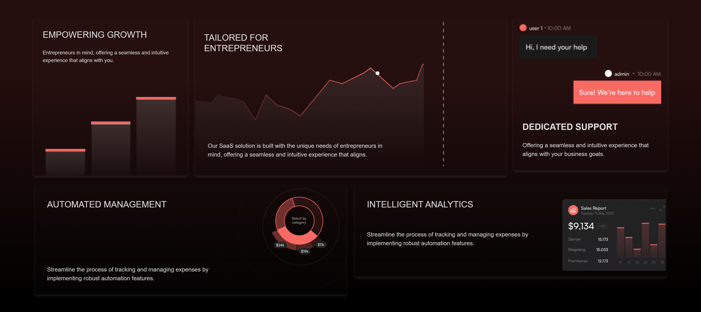
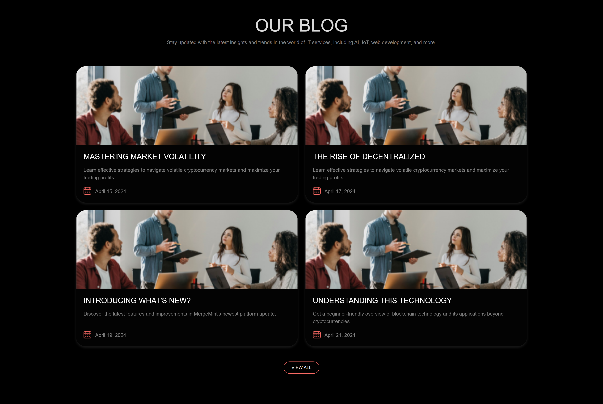
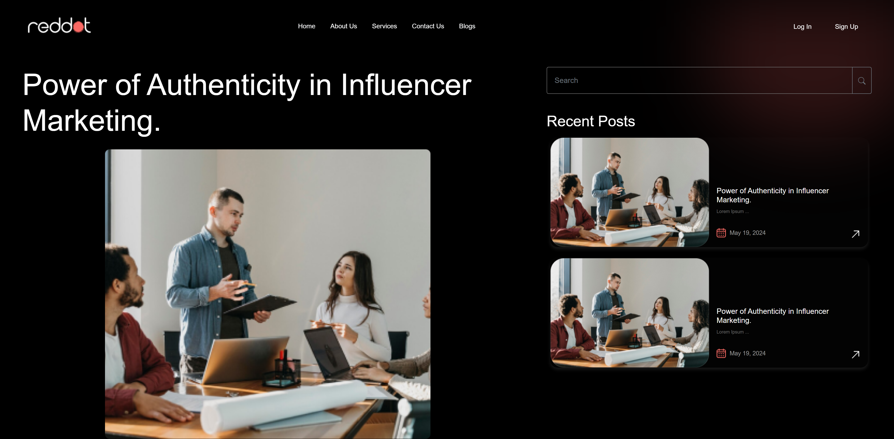
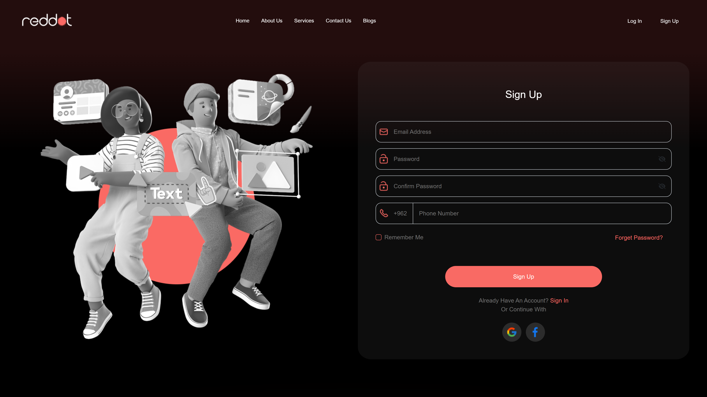

# Reddot

A responsive, multi-page business landing page for a consultancy brand
("Streamlined Operations — Maximized Revenue"), built during university
training from a provided Figma design. It showcases services, about, features,
FAQ, and blog, and includes authentication pages (sign in / sign up).

## Screenshots

### Features & Services Cards


### Blog Section


### Blog Details


### Sign Up Page


## Features

- Fixed navbar with scroll effect, responsive collapse, and Log In / Sign Up buttons
- Hero section with bold display headlines and imagery
- About and feature-cards sections with statistics
- Brand carousel (news ticker)
- FAQ accordion with animated arrows
- Blog preview section with dedicated details page
- Dedicated pages: Services, Contact, FAQ, Policy, Terms
- Sign in / sign up pages (two design variants each)
- AOS scroll animations
- Footer with logo, social links, and decorative blur effects

## Technologies

- HTML
- CSS
- JavaScript
- Bootstrap 5
- jQuery
- Swiper
- AOS
- Owl Carousel
- Fancybox
- Font Awesome + Bootstrap Icons

## Project Structure

```text
css/            # main-design.css stylesheet
js/             # main-design.js interactions
view/           # HTML pages (landing, services, blogs, auth, ...)
Resources/img/  # site images and assets
screenshots/    # screenshots used in this README
README.md
```

## Notes

> **Note:** This is a university training project recreating a provided Figma
> design for learning purposes only — practicing responsive layouts, Bootstrap 5
> components, navbar/scroll effects, FAQ accordions, carousels, AOS animations,
> and multi-page frontend structure. All credit for the original design belongs
> to its respective authors.
