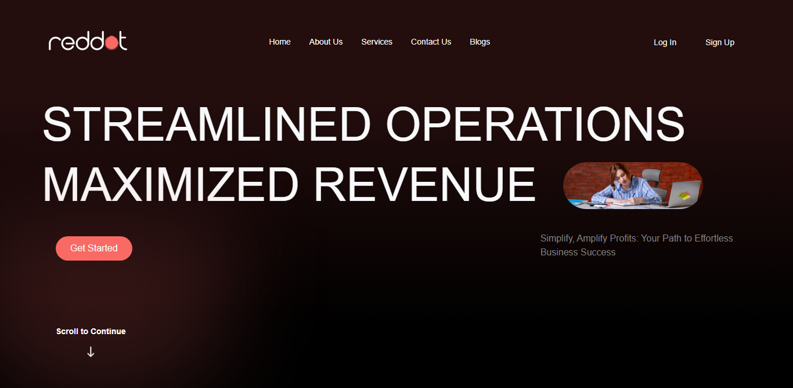

# RedDot — Responsive Multi-Page Consultancy Website

A responsive, multi-page consultancy website built with HTML, CSS, JavaScript, and Bootstrap 5 during university training, based on a provided Figma design. The project includes service and business information pages, a blog with a dedicated details page, FAQ, and authentication interfaces.

## Screenshots

### Home Page


### Features & Services Cards


### Blog Section


### Blog Details


### Sign Up Page


## Features

- Fixed navbar that changes on scroll, with responsive collapse and Log In / Sign Up buttons
- Hero section with bold display headlines and imagery
- About section with a statistics display and feature-card sections with chart imagery
- Auto-playing brand ticker carousel of partner logos
- FAQ accordion with animated arrows
- Blog preview section with a blog list page and a dedicated blog details page
- Dedicated pages: Services, FAQ, Policy, Terms, Contact Us
- Sign in and sign up pages, each with an additional (v2) version
- Password show/hide toggle on authentication forms
- AOS scroll animations
- Footer with logo, social links, and decorative blur effects

## Technologies

- HTML
- CSS
- JavaScript
- Bootstrap 5
- jQuery
- AOS
- Owl Carousel
- Font Awesome + Bootstrap Icons

## Project Structure

```text
css/            # main-design.css stylesheet
js/             # main-design.js interactions
view/           # HTML pages (landing, services, blogs, auth, ...)
Resources/img/  # site images and assets
screenshots/    # screenshots used in this README
README.md
```

## Notes

> **Note:** This project was developed during university training by recreating a provided Figma design for learning purposes. It demonstrates practice with responsive layouts, Bootstrap 5, interactive UI components, animations, carousels, and multi-page frontend development. Credit for the original design belongs to its respective authors.
